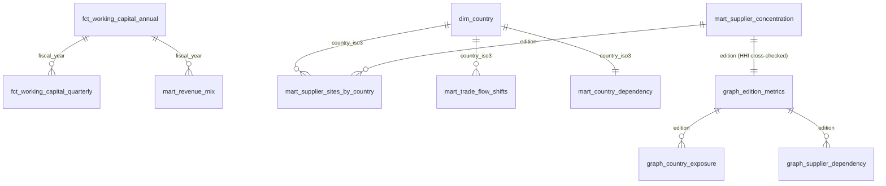

# Apple supply chain analytics on AWS (batch + graph)

[](https://github.com/rohit91jacob/apple-supply-chain-aws/actions/workflows/ci.yml)
[](https://github.com/rohit91jacob/apple-supply-chain-aws/actions/workflows/refresh.yml)
[](https://rohit91jacob.github.io/apple-supply-chain-aws/)
[](LICENSE)
[](DATA_LICENSE.md)


How exposed is Apple's supply chain to a single country, and how does that show up in its
working capital? This project answers that from public data only:

* **SEC EDGAR XBRL** for Apple's inventory, cost of sales, payables, receivables, vendor
  non-trade receivables, purchase obligations and net sales by segment, product and country
  (FY2007-FY2026 Q3).
* **Apple's annual Supplier List** (nine editions, 2014-2024), parsed from the PDFs at
  runtime into a supplier → country network.
* **UN Comtrade** (keyless public preview API) for who exports the world's phones (HS 8517,
  851712/851713/851714) and computers (HS 8471), 2015-2024.

It is built as an AWS-native batch pipeline - **Step Functions orchestrating Lambda
extractors → S3 → Iceberg tables in a Glue-style catalog → dbt → a supplier network graph
(Neptune in the cloud mapping)** - and runs end to end on a laptop and in CI with the AWS parts
**emulated**: the real Step Functions definition is executed by a local interpreter, S3 is a
directory (or moto / LocalStack), the Glue catalog is pyiceberg's SQLite catalog, Athena is
DuckDB and Neptune is networkx. The Terraform for the real services is validated
(fmt, validate, tflint, checkov) but **has not been deployed** by the author.

## Results (live run, 9 October 2026)

| | |
|---|---|
| **Days inventory outstanding, FY2025** | **10.7 days** (average inventory $6.5 B on $221.0 B cost of sales); 5.8 days in FY2015 |
| **Days payable outstanding, FY2025** | **114.3 days**; cash conversion cycle **−71.6 days** (suppliers fund the operating cycle) |
| **Manufacturing purchase obligations** | **$56.2 B** at FY2025 year end, 92.6 days of cost of sales ($71.1 B / 115.8 days at the FY2022 peak) |
| **Supplier footprint, 2024 list (FY2023 spend)** | 187 suppliers in 28 countries; China mainland holds 33.4% of supplier-country pairs (38.6% in the 2019 list), Viet Nam 7.4% (3.6%), India 3.0% (1.8%) |
| **Concentration (HHI over countries)** | 0.153 on supplier-country pairs in 2024, down from 0.194 in 2017 |
| **Disruption scenario: China mainland cut off (2024 list)** | 37.5% of listed sites exposed; 84.0% of suppliers have at least one site there; **29.9% (56 suppliers) have no listed site outside it**. China mainland + Taiwan: 43.8% of sites, 38.5% of suppliers with no alternative |
| **Trade-flow shift** | India's HS 8517 exports rose from $0.8 B (2015) to $21.8 B (2024); its share of US cellular-phone imports from the countries tracked went from 0.0% to 13.6% while Viet Nam's fell from 19.5% (2019) to 4.4% (2024) and China's was 81.1% |
| **Geographic revenue mix** | Greater China 25.1% of net sales in FY2015 → 15.5% in FY2025; Services 8.5% → 26.2% |

**Verification:** 114 of 114 figures (net sales, cost of sales, gross margin, five segments,
five product categories, five balance-sheet lines and capex, FY2022-FY2025) match Apple's own
published Q4 condensed statements exactly. One mismatch is reported openly: the 2017 Supplier
List parses to 201 suppliers where Apple says "top 200". Trade data are only checked for
internal consistency. Details: [docs/verification.md](docs/verification.md).

The results site is rebuilt weekly by `refresh.yml` and published to GitHub Pages; until the
repository is published it can be generated locally with `make report`.

## Architecture


| Component | What it does | Code |
|---|---|---|
| Extractors (Lambda handlers) | Download each source, validate it, land it unchanged in the raw bucket keyed by sha256 with a `_latest` pointer; filed 10-Ks and archived PDFs are never re-downloaded | `extract.py`, `sources/`, `raw.py`, `lambdas/handlers.py` |
| Polite HTTP client | Per-host spacing (SEC ≤ ~7 req/s, Comtrade 3 s), retries with backoff on 429/5xx, descriptive User-Agent | `http.py` |
| Silver | Parses companyfacts, XBRL instances (dimensional segment/product/country facts), 10-K text (purchase obligations), PDFs (two layouts + ruled tables) and Comtrade JSON into typed Iceberg tables with lineage | `transform/silver.py`, `lakehouse/iceberg.py` |
| Data-quality gates | 19 silver + 7 gold checks; error-level failures stop the state machine (exit 3) | `quality.py` |
| dbt | 17 models (staging → intermediate → marts), 59 data tests; DuckDB locally, Athena target compiled in CI | `dbt/` |
| Supplier graph | Bipartite supplier-country graph per edition; HHI, single-country dependency, disruption scenarios; Neptune Gremlin CSVs | `graph/` |
| Orchestration | The ASL definition (also rendered by Terraform) plus a local interpreter for Task/Parallel/Choice/Pass/Fail with Retry/Catch | `orchestration/` |
| Verification | Downloads Apple's Q4 statements and reconciles 114 figures | `verify.py` |
| Results site | One static HTML page with inline SVG charts and data tables, plus `summary.json` | `report/site.py` |
| Infrastructure | Terraform modules for all of the above on AWS | `infra/` |

## Tech stack

| Layer | Local / CI (what actually runs) | Version |
|---|---|---|
| Language, packaging | Python, uv (`uv.lock`) | 3.12.12, uv 0.10 |
| Orchestration | `state_machine.asl.json` executed by `orchestration/local_sfn.py` | - |
| Object storage | filesystem; boto3 against moto (unit tests) and LocalStack (CI) | boto3 1.43, moto 5.2.3, LocalStack 4.14.0 |
| Table format, catalog | Apache Iceberg via pyiceberg, SQLite `SqlCatalog` (Glue stand-in) | pyiceberg 0.12.0, pyarrow 26.0 |
| Transformations | dbt-core + dbt-duckdb on DuckDB; dbt-athena for the compile-only Athena target | dbt-core 1.12.5, dbt-duckdb 1.11.0, duckdb 1.5.6, dbt-athena-community 1.11.1 |
| Graph | networkx | 3.7 |
| PDF parsing | pdfplumber | 0.11.10 |
| IaC | Terraform, AWS provider, tflint (+ AWS ruleset), checkov | 1.16.5, 6.68.0, 0.64.0 (+0.49.0), 3.3.26 |
| Quality | ruff, pytest, pre-commit, gitleaks | 0.16.10, 9.1.1, 4.x, 8.30.1 |

## Data sources

| Source | What is used | Licence / terms | Refresh cadence | Known gaps |
|---|---|---|---|---|
| [SEC EDGAR APIs](https://www.sec.gov/search-filings/edgar-application-programming-interfaces) - `companyfacts`, `submissions`, 10-K folders | 13 us-gaap concepts (all 10-K/10-Q facts), dimensional net sales from every 10-K instance since FY2009, purchase-obligation text | Public information, may be redistributed ([SEC policy](https://www.sec.gov/privacy)); User-Agent required | New 10-Q/10-K about every three months (Apple's FY ends late September; 10-K ~early November) | Segment/product mixes before FY2013 use other category schemes and are excluded from the mix mart; manufacturing purchase obligations missing for FY2009 |
| Apple Supplier List ([current edition](https://www.supplychainreports.apple/Apple-Supplier-List)) | Supplier names, countries, facility addresses (2014-2019) or provinces/states (2021+) | © Apple - parsed at runtime, never committed | Annually (spring) | 2016 and 2020 editions not retrievable (not archived under the known URLs); the newest edition Apple links is still the 2024 (FY2023) list; "sites" changes meaning between layouts (facilities vs provinces) |
| [UN Comtrade](https://comtradeplus.un.org/) public preview | Annual exports to World for 11 reporters, and US imports by partner, HS 8517 / 8471 / 851712 / 851713 / 851714 | © UN; limited derived figures may be published, raw data not redistributed | Reporters submit through the year; annual data revised | Preview: 1 period and ≤500 rows per call; Viet Nam 2024 exports not yet reported at build time; shares are of the 11 selected countries, not of world trade |
| US Census international trade API (optional) | US general imports by country, HS4 | Public domain; free API key required | Monthly | Skipped unless `CENSUS_API_KEY` is set (it was not set for the runs reported here) |

Licences and what is committed: [DATA_LICENSE.md](DATA_LICENSE.md). **Real vs synthetic:** the
committed test fixtures for SEC EDGAR are real (trimmed). The fixtures for the Supplier List and
Comtrade are **synthetic** (fictional supplier names, seeded random values), generated at test
time because those sources may not be redistributed; every synthetic file and the fixture-built
results site say so.

## Data model



Silver: `financial_facts`, `segment_revenue`, `purchase_obligations`, `supplier_sites`,
`trade_flows`, `census_imports`, `ref_country`, `raw_manifest`. Every column is described in
[docs/data_dictionary.md](docs/data_dictionary.md).

## Quickstart

Prerequisites: [uv](https://docs.astral.sh/uv/) (Python 3.12 is installed by uv). Terraform 1.16
and tflint only for the infrastructure checks. No Docker and no cloud account are needed.

```bash
git clone https://github.com/rohit91jacob/apple-supply-chain-aws && cd apple-supply-chain-aws
make install            # uv sync --frozen --all-groups
make help               # every target

# 1. Offline: the whole state machine on fixtures (~30 s)
make pipeline-fixtures

# 2. Real data (first run downloads ~80 MB in 4-8 min, depending on Comtrade 429 back-off; later runs 3-4 min)
export ASC_DATA_DIR=~/asc-data              # keep downloads outside the repo
export SEC_USER_AGENT="Your Name you@example.com"
uv run asc pipeline                         # extract -> silver -> DQ -> dbt -> graph -> DQ
uv run asc verify                           # reconcile with Apple's published statements
uv run asc report --out site                # open site/index.html
uv run asc sql "select fiscal_year, dio_days, dpo_days, ccc_days from marts.fct_working_capital_annual order by 1"
```

| Command | Purpose |
|---|---|
| `make test` | unit + end-to-end tests (offline) |
| `make test-live` | live checks against SEC, Comtrade and the current Supplier List |
| `make dbt-compile-athena` | compile the dbt project for Athena (AWS calls sunk into moto) |
| `make infra-check` | terraform fmt / validate, tflint, checkov |

Configuration is environment variables only ([.env.example](.env.example)); `make` reads a
local `.env` if present.

## Cloud mapping: local emulator → AWS service

| Concern | Runs locally / in CI as | On AWS (Terraform in `infra/`) |
|---|---|---|
| Orchestration | `state_machine.asl.json` interpreted by `local_sfn.py`; definition also accepted by moto and LocalStack Step Functions | AWS Step Functions (Standard), X-Ray, KMS-encrypted logs; EventBridge Scheduler weekly (Mon 06:00 UTC) |
| Compute | handler functions called in-process | 9 Lambda functions from one arm64 container image (ECR, immutable tags, scan on push), DLQs, reserved concurrency 2 |
| Raw / curated storage | directories under `$ASC_DATA_DIR/lake`; moto S3; LocalStack S3 | S3 (SSE-KMS, versioning, TLS-only, access logs, lifecycle) |
| Table format + catalog | Iceberg + pyiceberg SQLite catalog; Iceberg on moto/LocalStack S3 tested | Iceberg in S3, AWS Glue Data Catalog (`asc_silver`, `asc_gold`, dbt schemas), catalog encryption |
| SQL / dbt | DuckDB (dbt-duckdb) | dbt-duckdb inside the BuildMarts Lambda (warehouse file handed between functions via S3), or `DBT_TARGET=athena` with Athena engine v3 (workgroup with 1 GiB scan cutoff) |
| Graph | networkx | Amazon Neptune Serverless (optional, off by default) loaded from the Gremlin CSVs |
| Alerts | CLI exit codes, GitHub issue from `refresh.yml` | EventBridge rule on FAILED/TIMED_OUT/ABORTED → SNS (KMS) |
| Cost control | - | AWS Budgets (US$10/month default, tag-scoped) |
| CI/CD auth | - | GitHub OIDC role (repository + environment scoped; ECR push, Lambda image update, StartExecution only) |

## Testing and CI

* **Unit** (67 tests): parsers on real SEC fixtures and synthetic PDFs/JSON for every layout,
  country resolution, the ASL interpreter (retry, catch, DQ gate → Fail), ASL rendering, graph
  metrics with hand-computed answers, raw-zone idempotency on disk and on moto S3, Iceberg on
  S3 + Glue registration against a moto server, the state machine accepted by moto Step
  Functions, config validation, the verification parser.
* **End-to-end** (3 tests, 1-4 min depending on the machine): the full state machine on fixtures; an immediate rerun lands
  nothing new and produces identical marts and graph tables; a corrupted (negative) trade value
  stops the run at `CheckSilver` with exit code 3; each CLI stage run individually.
* **Live** (`-m live`, 3 tests) and **LocalStack** (`-m localstack`, 2 tests: the fixture
  pipeline with `ASC_STORE=s3` and the state machine definition). The LocalStack job only runs
  in GitHub Actions (no Docker locally); its tests were exercised locally against a moto
  server standing in for LocalStack and passed.
* **CI** (`ci.yml`): lint + lockfile + gitleaks, unit, fixture pipeline + dbt build + rerun +
  e2e, Athena compile, Terraform (fmt/validate/tflint/checkov), LocalStack integration, and an
  arm64 Lambda image build. CI workflows have been written against pinned action SHAs but
  have not run on GitHub yet (the repository is not pushed).

## Cost notes

Locally and in CI: free. If deployed: a weekly run is ~3-4 minutes of Lambda time at 0.5-3 GB
(cents per month), S3 storage of ~100 MB, Step Functions at a few dozen state transitions per
run, CloudWatch Logs and a KMS key (~US$1/month). The one material cost would be Neptune
Serverless (minimum 1 NCU, billed while running), which is disabled by default. These are
estimates from published AWS pricing, not measured bills.

## Limitations

* **Emulation, not AWS.** The local Step Functions interpreter supports only the ASL subset this
  pipeline uses; Lambda limits (15 min, /tmp size, cold starts) are not exercised; the Lambda
  image build and the LocalStack job have not run yet; nothing was deployed.
* **Supplier List is a proxy.** It covers ~98% of direct spend but lists names and places, not
  volumes: shares and the disruption scenario count *suppliers and listed locations*, not
  dollars or capacity. Layout changed in 2021 (facilities → provinces), so the
  supplier-country pair is the comparable unit and "sites" is not comparable across that break.
  2016 and 2020 editions are missing; parsing of the 2017 edition yields 201 names.
* **Wayback dependency.** Older editions come from Internet Archive snapshots of apple.com URLs.
* **Trade shares** are relative to the 11 queried reporters/partners; Comtrade values are
  partly UNSD estimates and the latest year is incomplete for late reporters (Viet Nam 2024).
* **HS codes ≠ Apple.** HS 8517/8471 trade covers all brands; it shows where phone and computer
  assembly sits, not Apple's own shipments.
* **Purchase obligations** come from regex over 10-K prose/tables; a rephrased disclosure is
  caught by a DQ warning, not parsed automatically.
* The US Census source is implemented and unit-tested but was not run (no API key).

## Project structure

```
src/apple_supply_chain/
  cli.py              asc command
  sources/            edgar.py, supplier_list.py, comtrade.py, census.py
  extract.py raw.py   extractors + content-addressed raw zone
  transform/silver.py raw -> silver Iceberg
  lakehouse/          Iceberg catalog, Glue registration
  warehouse.py        Iceberg -> DuckDB -> dbt -> gold Iceberg
  graph/              networkx analysis, Neptune CSVs
  quality.py          DQ gates
  orchestration/      state_machine.asl.json, local interpreter, ARN rendering
  lambdas/handlers.py Lambda entry points
  report/site.py      results site
  verify.py           reconciliation with Apple's statements
  fixtures.py         SYNTHETIC fixture generation (PDF writer, Comtrade JSON)
dbt/                  staging / intermediate / marts + tests
infra/                Terraform modules + envs/dev
tests/                unit, e2e, integration (live, localstack), fixtures/http (real SEC)
docs/                 data_dictionary.md, runbook.md, verification.md
```

## License

Code: MIT ([LICENSE](LICENSE)). Data: see [DATA_LICENSE.md](DATA_LICENSE.md) - SEC EDGAR is
public information; the Apple Supplier List and Apple's statements are © Apple and are only
downloaded at runtime; UN Comtrade data are © United Nations.
