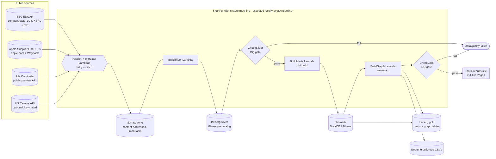
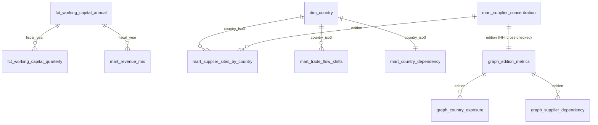

# Apple supply chain analytics on AWS (batch + graph)

[](https://github.com/rohit91jacob/apple-supply-chain-aws/actions/workflows/ci.yml)
[](https://github.com/rohit91jacob/apple-supply-chain-aws/actions/workflows/refresh.yml)
[](https://rohit91jacob.github.io/apple-supply-chain-aws/)
[](LICENSE)
[](DATA_LICENSE.md)


How exposed is Apple's supply chain to a single country, and how does that show up in its
working capital? This project answers that from public data only:

* **SEC EDGAR XBRL** for Apple's inventory, cost of sales, payables, receivables, vendor
  non-trade receivables, purchase obligations and net sales by segment, product and country
  (FY2007-FY2026 Q3).
* **Apple's annual Supplier List** (nine editions, 2014-2024), parsed from the PDFs at
  runtime into a supplier → country network.
* **UN Comtrade** (keyless public preview API) for who exports the world's phones (HS 8517,
  851712/851713/851714) and computers (HS 8471), 2015-2024.

It is built as an AWS-native batch pipeline - **Step Functions orchestrating Lambda
extractors → S3 → Iceberg tables in a Glue-style catalog → dbt → a supplier network graph
(Neptune in the cloud mapping)** - and runs end to end on a laptop and in CI with the AWS parts
**emulated**: the real Step Functions definition is executed by a local interpreter, S3 is a
directory (or moto / LocalStack), the Glue catalog is pyiceberg's SQLite catalog, Athena is
DuckDB and Neptune is networkx. The Terraform for the real services is validated
(fmt, validate, tflint, checkov) but **has not been deployed** by the author.

## Results (live run, 9 October 2026)

| | |
|---|---|
| **Days inventory outstanding, FY2025** | **10.7 days** (average inventory $6.5 B on $221.0 B cost of sales); 5.8 days in FY2015 |
| **Days payable outstanding, FY2025** | **114.3 days**; cash conversion cycle **−71.6 days** (suppliers fund the operating cycle) |
| **Manufacturing purchase obligations** | **$56.2 B** at FY2025 year end, 92.6 days of cost of sales ($71.1 B / 115.8 days at the FY2022 peak) |
| **Supplier footprint, 2024 list (FY2023 spend)** | 187 suppliers in 28 countries; China mainland holds 33.4% of supplier-country pairs (38.6% in the 2019 list), Viet Nam 7.4% (3.6%), India 3.0% (1.8%) |
| **Concentration (HHI over countries)** | 0.153 on supplier-country pairs in 2024, down from 0.194 in 2017 |
| **Disruption scenario: China mainland cut off (2024 list)** | 37.5% of listed sites exposed; 84.0% of suppliers have at least one site there; **29.9% (56 suppliers) have no listed site outside it**. China mainland + Taiwan: 43.8% of sites, 38.5% of suppliers with no alternative |
| **Trade-flow shift** | India's HS 8517 exports rose from $0.8 B (2015) to $21.8 B (2024); its share of US cellular-phone imports from the countries tracked went from 0.0% to 13.6% while Viet Nam's fell from 19.5% (2019) to 4.4% (2024) and China's was 81.1% |
| **Geographic revenue mix** | Greater China 25.1% of net sales in FY2015 → 15.5% in FY2025; Services 8.5% → 26.2% |

**Verification:** 114 of 114 figures (net sales, cost of sales, gross margin, five segments,
five product categories, five balance-sheet lines and capex, FY2022-FY2025) match Apple's own
published Q4 condensed statements exactly. One mismatch is reported openly: the 2017 Supplier
List parses to 201 suppliers where Apple says "top 200". Trade data are only checked for
internal consistency. Details: [docs/verification.md](docs/verification.md).

The results site is rebuilt weekly by `refresh.yml` and published to GitHub Pages; until the
repository is published it can be generated locally with `make report`.

## Architecture



| Component | What it does | Code |
|---|---|---|
| Extractors (Lambda handlers) | Download each source, validate it, land it unchanged in the raw bucket keyed by sha256 with a `_latest` pointer; filed 10-Ks and archived PDFs are never re-downloaded | `extract.py`, `sources/`, `raw.py`, `lambdas/handlers.py` |
| Polite HTTP client | Per-host spacing (SEC ≤ ~7 req/s, Comtrade 3 s), retries with backoff on 429/5xx, descriptive User-Agent | `http.py` |
| Silver | Parses companyfacts, XBRL instances (dimensional segment/product/country facts), 10-K text (purchase obligations), PDFs (two layouts + ruled tables) and Comtrade JSON into typed Iceberg tables with lineage | `transform/silver.py`, `lakehouse/iceberg.py` |
| Data-quality gates | 19 silver + 7 gold checks; error-level failures stop the state machine (exit 3) | `quality.py` |
| dbt | 17 models (staging → intermediate → marts), 59 data tests; DuckDB locally, Athena target compiled in CI | `dbt/` |
| Supplier graph | Bipartite supplier-country graph per edition; HHI, single-country dependency, disruption scenarios; Neptune Gremlin CSVs | `graph/` |
| Orchestration | The ASL definition (also rendered by Terraform) plus a local interpreter for Task/Parallel/Choice/Pass/Fail with Retry/Catch | `orchestration/` |
| Verification | Downloads Apple's Q4 statements and reconciles 114 figures | `verify.py` |
| Results site | One static HTML page with inline SVG charts and data tables, plus `summary.json` | `report/site.py` |
| Infrastructure | Terraform modules for all of the above on AWS | `infra/` |

## Tech stack

| Layer | Local / CI (what actually runs) | Version |
|---|---|---|
| Language, packaging | Python, uv (`uv.lock`) | 3.12.12, uv 0.10 |
| Orchestration | `state_machine.asl.json` executed by `orchestration/local_sfn.py` | - |
| Object storage | filesystem; boto3 against moto (unit tests) and LocalStack (CI) | boto3 1.43, moto 5.2.3, LocalStack 4.14.0 |
| Table format, catalog | Apache Iceberg via pyiceberg, SQLite `SqlCatalog` (Glue stand-in) | pyiceberg 0.12.0, pyarrow 26.0 |
| Transformations | dbt-core + dbt-duckdb on DuckDB; dbt-athena for the compile-only Athena target | dbt-core 1.12.5, dbt-duckdb 1.11.0, duckdb 1.5.6, dbt-athena-community 1.11.1 |
| Graph | networkx | 3.7 |
| PDF parsing | pdfplumber | 0.11.10 |
| IaC | Terraform, AWS provider, tflint (+ AWS ruleset), checkov | 1.16.5, 6.68.0, 0.64.0 (+0.49.0), 3.3.26 |
| Quality | ruff, pytest, pre-commit, gitleaks | 0.16.10, 9.1.1, 4.x, 8.30.1 |

## Design rationale

Six constraints shaped the design. The data is **public, but on its owners' terms**: SEC EDGAR
may be redistributed but wants a declared User-Agent and under 10 requests a second, while the
Supplier List PDFs are © Apple and UN Comtrade data may not be re-disseminated as-is, so both are
fetched at runtime and never committed. The sources **change slowly and unevenly**: a 10-Q or
10-K about every three months, one Supplier List a year, filed documents never, and the keyless
Comtrade preview returns one period and at most 500 rows per call. Everything must **run without
an AWS account, credentials or Docker**, on a laptop and on free GitHub runners, the weekly
refresh included. **Local code is deployment code**: the ASL, the nine Lambda handlers and the dbt
project are what `infra/` and the Dockerfile package, though that Terraform has never been
applied. Every figure must be **traceable and checkable**, back to the raw bytes it came from and,
for the financials, against Apple's own statements; and a deployment must fit a **small budget**
(US$10 a month by default, `infra/modules/budget`).

### Architecture decisions

| Decision | Why | Alternatives considered | Trade-off accepted |
|---|---|---|---|
| **Fetch at runtime; commit only what may be redistributed.** `http.py` sends a User-Agent, spaces requests per host (SEC 0.15 s, Wayback 1 s, Comtrade 3 s) and backs off on 429/5xx; offline runs replay a mirrored HTTP tree through `FixtureFetcher` (`fetch.py`): trimmed real responses for SEC, files generated at test time and labelled SYNTHETIC for the Supplier List and Comtrade (`fixtures.py`) | Offline runs exercise the same fetch, land and parse code as live ones while the licensed sources stay out of git. The generated files use the parsers' exact formats and cover every Supplier List layout (address, locations, ruled table); the real SEC fixtures let the e2e test assert Apple's FY2025 figures through the whole chain | Committing trimmed real PDFs and Comtrade responses (the terms do not allow it); mocking at the parser boundary (skips landing, hashing and lineage) | The synthetic PDFs exercise only the layouts they reproduce, so a real layout change surfaces in the weekly refresh or the live tests (`-m live`), not in CI |
| **A content-addressed, immutable raw zone** (`raw.py`). Each payload lands once as `source=<source>/dataset=<dataset>/item=<item>/<sha256>.<ext>` behind a `_latest.json` pointer that records URL and fetch time; filed 10-Ks and Wayback snapshots are not fetched again once landed (`extract.py`); Comtrade responses are canonicalised before hashing (volatile `elapsedTime` dropped, keys sorted) | Step Functions retries, weekly refreshes and backfills land nothing unless the upstream bytes changed. A restated filing lands as a new object and moves the pointer while earlier versions stay addressable; silver rows keep `source_sha256`, and a gate fails the run if a fact, segment, supplier or trade row has no landed object behind it | Date-partitioned landing (a copy of unchanged data every week, deduplicated later); overwriting one key per item (no record of the bytes a figure came from before a restatement) | Mutable sources (companyfacts, submissions, the current Supplier List, Comtrade) are still downloaded on every run to compute the hash; deduplication needs byte-identical responses, so any new volatile field has to be canonicalised away |
| **Rebuild everything downstream of raw on every run** (`transform/silver.py`, `lakehouse/iceberg.py`). Each silver and gold table is rewritten in full on every run (one Iceberg `overwrite` commit), starting from the current pointers; a schema change drops and recreates the table | The inputs are small (about 80 MB on a first download), so there is no incremental state to get wrong: the restatement rules (latest filing wins, whole member sets from one filing, `sources/edgar.py`) and any parser fix apply to all history at once. A rerun writes the same rows (the e2e test compares marts and graph tables across two runs) and Iceberg keeps the previous snapshot | Incremental appends or a `MERGE` per filing (restatements and recasts handled in two places); plain Parquet rewrites (no atomic swap, no history) | Every run re-parses every PDF and filing (a cold rebuild from the cached raw zone took 240 s locally, `docs/verification.md`); snapshots accumulate with nothing expiring them; a schema change discards the table's history |
| **Data-quality gates as Choice states** (`quality.py`). 19 silver checks run after `BuildSilver` and 7 gold checks after `BuildGraph`; an error-level failure routes to `DataQualityFailed` (CLI exit 3), a warning is only reported | Source or parser drift (a renamed XBRL member, a new country spelling, a negative trade value) has to stop the run before the marts and the site are rebuilt. The checks are domain invariants: segment, product and country sales reconcile to total net sales within 0.5% from FY2013, 6-digit phone codes never sum above HS 8517, every landed edition yields rows. The e2e test corrupts one Comtrade value and asserts `BuildMarts` never starts | dbt tests alone (they run inside `BuildMarts` and never see the graph outputs); Great Expectations or Soda (a second framework for 26 counting queries) | Thresholds are hand-set (0.5%, at most 1% unresolved countries, 150-250 suppliers); known historical gaps are warnings, which neither block nor alert; a gate checks a layer that is already written, so it protects the next layer and the published site, not its own |
| **One ASL definition, two executors** (`orchestration/`). Terraform renders `state_machine.asl.json` with `templatefile()`; `local_sfn.py` interprets the same file and calls the handlers in-process; moto and LocalStack Step Functions accept the rendered definition | The control flow that ships (parallel extractors, Retry rules, the Catch that lets the optional Census source fail without failing the run, both gates) is what every local run, CI job and weekly refresh executes; each run writes a Step Functions-style history to `$ASC_DATA_DIR/runs/<run_id>.json` | A Python runner locally and hand-written ASL for AWS (two definitions that drift); one Lambda running every stage (no per-stage retry, catch or gate, and one 15-minute limit for all of it) | The interpreter covers only what the definition uses (`lambda:invoke` Tasks, dotted JSONPath, three Choice operators) and runs Parallel branches one after another; neither emulator executes the definition, so Step Functions itself is untested until a deployment |
| **dbt on DuckDB in every environment; Athena compile-checked** (`warehouse.py`, `lambdas/handlers.py`). `BuildMarts` loads the current silver snapshots into DuckDB, runs `dbt build` and writes the marts back to Iceberg `gold`; on AWS the checkpointed DuckDB file is copied to `s3://<curated>/warehouse/duckdb/asc.duckdb` for `BuildGraph` and `CheckGold`, because each Lambda has its own `/tmp` | One engine runs the models, tests, gates and graph input on a laptop, in CI and in the deployed functions, so the deployed SQL is the tested SQL, and readers get Iceberg either way. The same project compiles for Athena (`generate_schema_name`, Iceberg marts via `table_type`); CI compiles it against an in-process moto server, so no AWS call escapes | Athena on every run (the gates and the graph stage would need to query Athena, and the image would need dbt-athena); separate SQL per engine (drift); a local Trino or Spark stand-in (Docker or a JVM) | The Athena SQL is compiled, never executed; the warehouse file is copied whole between functions under one S3 key, so executions must not overlap |
| **Supplier-country pairs, with the graph metrics computed twice** (`int_supplier_country_pairs.sql`, `graph/network.py`). The 2021 layout change (facilities → provinces/states) leaves supplier × country as the only comparable unit; HHI and single-country counts are computed in dbt SQL and again in networkx, and a gold gate requires them to agree (HHI within 1e-9) | The bipartite graph answers the disruption question directly: remove a set of countries and count the suppliers left with no listed site. The SQL marts carry the same metrics to Athena, two independent implementations catch an error in either, and per-edition Gremlin bulk-load CSVs keep Neptune one load away | Counting sites across editions (the unit changes meaning in 2021); Neptune as the working store (a VPC cluster billed while it runs, for nine graphs of about 200 suppliers each); SQL only (finding the suppliers that removing a country isolates is a graph operation) | Counts suppliers and listed locations, not spend or capacity (see Limitations); two implementations to keep in step; nothing in the pipeline loads or queries Neptune |
| **Reconcile with a separate publication** (`verify.py`). `asc verify` downloads Apple's Q4 condensed statements (FY2023-FY2025 PDFs) and compares 114 figures with the marts; any mismatch exits 4 | The newsroom PDFs are published separately from the XBRL the pipeline reads, so a match checks the whole chain (fact selection, restatement rule, member canonicalisation, fiscal-year assignment, marts); checking against companyfacts would be circular | Spot checks by hand (not repeatable); a commercial fundamentals feed (licensing, and its own definitions) | Covers FY2022-FY2025 and only the lines Apple prints; purchase obligations and trade data are checked for internal consistency only; `refresh.yml` runs it with `continue-on-error`, so a mismatch is reported, not blocked |
| **Keyless deploy, manual infrastructure** (`infra/modules/github_oidc`, `deploy.yml`). The deploy role trusts only this repository's `aws-dev` environment and may only push to its ECR repository, repoint the nine functions and start or describe executions of this state machine; `deploy.yml` does nothing until `AWS_DEPLOY_ROLE_ARN` is set | No long-lived keys. A compromised workflow can ship an image (tagged with the commit SHA in an immutable-tag repository) but cannot change IAM, buckets, the state machine or the schedule | Static access keys in repository secrets; `terraform apply` from CI (a CI role with IAM write access) | Every infrastructure change needs someone with account credentials; the stack has never been applied, so the IAM scoping is reasoned about, not exercised |

### Stack choices

| Layer | Choice (version in `uv.lock` / pins) | Why this | Why not the alternatives |
|---|---|---|---|
| Language / packaging | Python 3.12.12, uv 0.10.2 | One language for extractors, parsers, gates, graph, site and all nine handlers, matching the `python:3.12-arm64` Lambda base image. uv installs the interpreter, syncs the lock (`--frozen`), exports the image's requirements (`uv export --no-dev`) and fails CI on a stale lock (`uv lock --check`) | Poetry or pip-tools (slower, and neither installs the interpreter; uv covers interpreter, lock and export in one tool) |
| Orchestration | AWS Step Functions (Standard), started weekly by EventBridge Scheduler (Mon 06:00 UTC); locally `local_sfn.py` | Native Parallel, Retry, Catch and Choice for nine Lambda tasks, priced per state transition, with X-Ray and KMS-encrypted logs. Standard because a first run with an empty raw zone takes 4-8 minutes locally and Express executions stop at five | Amazon MWAA (an always-on Airflow environment for one weekly nine-task run); a cron-triggered chain of Lambdas (no execution history, hand-rolled retries) |
| Compute | AWS Lambda: nine functions from one arm64 container image in ECR (immutable tags, scan on push); 512-3,008 MB, up to 4 GB of `/tmp`, 15-minute timeout, reserved concurrency 2 | Each stage is a short batch step with its own memory, `/tmp` and data scope (`raw_write`, `silver_write`, `gold_write`, `lake_read`), built from one locked dependency set. No VPC: the extractors call public APIs, and a NAT gateway would add cost for no security gain on public data (checkov skip in `infra/modules/lambda_function`) | ECS Fargate or AWS Batch (task definitions and networking for steps that take minutes); AWS Glue jobs (a different runtime from the one tested locally); zip packages (nine bundles, or layers, of the same dependencies) |
| Object storage | S3 (SSE-KMS, versioned, TLS-only, access-logged; raw moves to Standard-IA after 30 days); boto3 1.43, moto 5.2.3, LocalStack 4.14.0 (CI service container, pinned by digest) | One `ObjectStore` interface (`storage.py`) with a directory backend (atomic rename) and a boto3 backend, so the same landing code runs on a laptop, on moto (unit tests, no Docker or network), on LocalStack (CI, a real HTTP endpoint) and on S3; `AWS_ENDPOINT_URL` selects the emulator | LocalStack everywhere (Docker, which the Quickstart does not require); a sandbox AWS account in CI (credentials and a bill the keyless refresh avoids) |
| Table format / catalog | Apache Iceberg via pyiceberg 0.12.0 and pyarrow 26.0; SQLite `SqlCatalog` locally, AWS Glue Data Catalog on AWS (`ASC_CATALOG=glue`) | Atomic full-table overwrites with snapshot history from plain Python, in a laptop process or a Lambda, with Arrow as the hand-off to DuckDB. The SQLite catalog is a zero-infrastructure stand-in for Glue (`lakehouse/glue_sync.py` mirrors it into Glue, tested against moto); Athena engine v3 reads the Glue tables and dbt-athena writes its marts as Iceberg | Delta Lake via delta-rs (Athena reads Delta but cannot write it, so Athena marts could not share the format); plain Parquet (no atomic replace, no history); Spark with Iceberg (a JVM and a cluster for single-process loads) |
| Transformations / SQL | dbt-core 1.12.5 and dbt-duckdb 1.11.0 on DuckDB 1.5.6; dbt-athena-community 1.11.1 (compile only) for Athena engine v3, whose workgroup cancels queries over 1 GiB scanned | `dbt build` runs 17 models and 59 data tests in dependency order, and a failure fails `BuildMarts`. DuckDB is in-process and reads Arrow directly; the project uses no dbt packages, so it builds offline, and `profiles.yml` holds no credentials (paths and AWS settings come from environment variables). dbt-core, dbt-duckdb, duckdb and pyiceberg are bumped together by hand (`dependabot.yml`) | Hand-run SQL scripts (no tests, lineage or ordering); pandas or Polars code per mart (no Athena equivalent); a local Trino container (closest to Athena, but Docker) |
| Graph | networkx 3.7; Amazon Neptune Serverless (optional, `enable_neptune = false`, capped at 2.5 NCU) loaded from Gremlin CSVs | Pure Python and in-process; each metric (degree-based HHI, bipartite density, node removal for disruption scenarios) is a few lines, and the graphs are small (187 suppliers in 28 countries in the 2024 list). The bulk-load files keep the Neptune mapping concrete without a running cluster | Neptune as the working store (VPC-only and billed while it runs, from 1 NCU); igraph or graph-tool (compiled libraries for graphs this size) |
| PDF parsing | pdfplumber 0.11.10 (on pdfminer.six and pypdfium2) | Word coordinates (`extract_words`) let the parser find each page's columns from the header words and rebuild rows, and `extract_tables` reads the ruled 2021 edition. It installs from wheels, so `docker/lambda.Dockerfile` adds no system packages | tabula-py (a JVM); PyMuPDF (AGPL licence in an MIT project) |
| IaC | Terraform 1.16.5, AWS provider 6.68.0 (`~> 6.68`), tflint 0.64.0 with AWS ruleset 0.49.0, checkov 3.3.26 | `init -backend=false` and `validate` need no credentials, so CI checks the whole stack without an account; `templatefile()` injects the shared ASL; the S3 backend locks with a lock file (no DynamoDB table); every checkov skip states its reason inline | AWS CDK (a Node.js toolchain and a bootstrap stack per account and region); Pulumi (its own engine and state backend for the same resources) |
| Quality / CI | ruff 0.16.10, pytest 9.1.1, pre-commit 4.6.2 (ruff, gitleaks 8.30.1, terraform fmt, 300 KB file limit, private-key check), GitHub Actions | ruff lints and formats in one tool; pytest markers split unit, e2e, live and LocalStack runs. GitHub Actions gives a public repository free x86 and arm64 runners, service containers, cron, Pages and OIDC to AWS in one place, with every action pinned by SHA | flake8 + black + isort (three tools for one job); AWS CodeBuild or CodePipeline (an AWS account for a refresh built to need none); a self-hosted Jenkins (a server to run) |
| Results site | Static HTML with inline SVG charts from `report/site.py`, plus `summary.json`, on GitHub Pages | No JavaScript framework and no external assets; every number on the page is read from the warehouse, and `refresh.yml` publishes it with each data refresh | Amazon QuickSight (an AWS account and per-user pricing for readers); Streamlit or Dash (a server to host); a charting library from a CDN (external assets) |

### What would change in production

* **Marts and gates through Athena, not a DuckDB file.** The image installs only the runtime
  dependencies (`uv export --no-dev`), so the deployed `BuildMarts` runs dbt-duckdb and hands one
  DuckDB file through S3 to the next two functions, which assumes one execution at a time. A
  deployment would add the `athena` group to the image, set `DBT_TARGET=athena` and run the gold
  gates and the graph input as Athena queries against the Glue databases (`asc_intermediate`,
  `asc_marts`, `asc_gold`).
* **Register new Supplier List editions automatically.** The current list comes from Apple's
  current-edition URL and is configured as edition 2024 (`sources/supplier_list.py`). The extract
  reads the fiscal year printed in that PDF and stops with an error naming the new year when it no
  longer matches (`stated_fiscal_year` in `sources/supplier_list.py`, checked in `extract.py`), so a
  new list is never filed under the old label; adding it is still a hand edit (a new `Edition`, and
  the previous one pinned to its Wayback snapshot). A deployment would register the new edition
  itself.
* **Keyed Comtrade access.** The keyless preview caps each call at 500 rows and one period and
  throttles per IP (`docs/runbook.md`), and trade shares are relative to 11 selected countries
  (see Limitations). A subscription key, held in SSM like the Census key (`lambdas/handlers.py`),
  would lift the preview limits, so the extractor could pull every reporter and report shares of
  world trade.
* **Table maintenance.** Every run adds an overwrite snapshot to each silver and gold table and
  nothing expires them; the curated bucket's lifecycle rule expires only noncurrent object
  versions, and Iceberg never overwrites a file in place. A scheduled Athena `VACUUM` would expire
  old snapshots and remove their files.
* **Alert on warnings, keep every check result.** Error-level failures fail the execution and
  reach SNS through the EventBridge rule, but a warning (a purchase-obligation sentence that no
  longer matches, a stale latest 10-K) shows up only as a count, since the gate states keep counts
  rather than check results. A deployment would append each result to an Iceberg table and alarm
  on new warnings.
* **Exercise what is only configured.** The Lambda limits, the image build and the LocalStack job
  are untested (see Limitations), the budget filter needs the `project` cost-allocation tag
  activated, and the function roles carry no permissions boundary (`permissions_boundary_arn` is
  supported but unset). A first deployment would go through `deploy.yml` into a sandbox account
  and measure each stage against its memory, `/tmp` and 15-minute limits.

## Data sources

| Source | What is used | Licence / terms | Refresh cadence | Known gaps |
|---|---|---|---|---|
| [SEC EDGAR APIs](https://www.sec.gov/search-filings/edgar-application-programming-interfaces) - `companyfacts`, `submissions`, 10-K folders | 13 us-gaap concepts (all 10-K/10-Q facts), dimensional net sales from every 10-K instance since FY2009, purchase-obligation text | Public information, may be redistributed ([SEC policy](https://www.sec.gov/privacy)); User-Agent required | New 10-Q/10-K about every three months (Apple's FY ends late September; 10-K ~early November) | Segment/product mixes before FY2013 use other category schemes and are excluded from the mix mart; manufacturing purchase obligations missing for FY2009 |
| Apple Supplier List ([current edition](https://www.supplychainreports.apple/Apple-Supplier-List)) | Supplier names, countries, facility addresses (2014-2019) or provinces/states (2021+) | © Apple - parsed at runtime, never committed | Annually (spring) | 2016 and 2020 editions not retrievable (not archived under the known URLs); the newest edition Apple links is still the 2024 (FY2023) list; "sites" changes meaning between layouts (facilities vs provinces) |
| [UN Comtrade](https://comtradeplus.un.org/) public preview | Annual exports to World for 11 reporters, and US imports by partner, HS 8517 / 8471 / 851712 / 851713 / 851714 | © UN; limited derived figures may be published, raw data not redistributed | Reporters submit through the year; annual data revised | Preview: 1 period and ≤500 rows per call; Viet Nam 2024 exports not yet reported at build time; shares are of the 11 selected countries, not of world trade |
| US Census international trade API (optional) | US general imports by country, HS4 | Public domain; free API key required | Monthly | Skipped unless `CENSUS_API_KEY` is set (it was not set for the runs reported here) |

Licences and what is committed: [DATA_LICENSE.md](DATA_LICENSE.md). **Real vs synthetic:** the
committed test fixtures for SEC EDGAR are real (trimmed). The fixtures for the Supplier List and
Comtrade are **synthetic** (fictional supplier names, seeded random values), generated at test
time because those sources may not be redistributed; every synthetic file and the fixture-built
results site say so.

## Data model



Silver: `financial_facts`, `segment_revenue`, `purchase_obligations`, `supplier_sites`,
`trade_flows`, `census_imports`, `ref_country`, `raw_manifest`. Every column is described in
[docs/data_dictionary.md](docs/data_dictionary.md).

## Quickstart

Prerequisites: [uv](https://docs.astral.sh/uv/) (Python 3.12 is installed by uv). Terraform 1.16
and tflint only for the infrastructure checks. No Docker and no cloud account are needed.

```bash
git clone https://github.com/rohit91jacob/apple-supply-chain-aws && cd apple-supply-chain-aws
make install            # uv sync --frozen --all-groups
make help               # every target

# 1. Offline: the whole state machine on fixtures (~30 s)
make pipeline-fixtures

# 2. Real data (first run downloads ~80 MB in 4-8 min, depending on Comtrade 429 back-off; later runs 3-4 min)
export ASC_DATA_DIR=~/asc-data              # keep downloads outside the repo
export SEC_USER_AGENT="Your Name you@example.com"
uv run asc pipeline                         # extract -> silver -> DQ -> dbt -> graph -> DQ
uv run asc verify                           # reconcile with Apple's published statements
uv run asc report --out site                # open site/index.html
uv run asc sql "select fiscal_year, dio_days, dpo_days, ccc_days from marts.fct_working_capital_annual order by 1"
```

| Command | Purpose |
|---|---|
| `make test` | unit + end-to-end tests (offline) |
| `make test-live` | live checks against SEC, Comtrade and the current Supplier List |
| `make dbt-compile-athena` | compile the dbt project for Athena (AWS calls sunk into moto) |
| `make infra-check` | terraform fmt / validate, tflint, checkov |

Configuration is environment variables only ([.env.example](.env.example)); `make` reads a
local `.env` if present.

## Cloud mapping: local emulator → AWS service

| Concern | Runs locally / in CI as | On AWS (Terraform in `infra/`) |
|---|---|---|
| Orchestration | `state_machine.asl.json` interpreted by `local_sfn.py`; definition also accepted by moto and LocalStack Step Functions | AWS Step Functions (Standard), X-Ray, KMS-encrypted logs; EventBridge Scheduler weekly (Mon 06:00 UTC) |
| Compute | handler functions called in-process | 9 Lambda functions from one arm64 container image (ECR, immutable tags, scan on push), DLQs, reserved concurrency 2 |
| Raw / curated storage | directories under `$ASC_DATA_DIR/lake`; moto S3; LocalStack S3 | S3 (SSE-KMS, versioning, TLS-only, access logs, lifecycle) |
| Table format + catalog | Iceberg + pyiceberg SQLite catalog; Iceberg on moto/LocalStack S3 tested | Iceberg in S3, AWS Glue Data Catalog (`asc_silver`, `asc_gold`, dbt schemas), catalog encryption |
| SQL / dbt | DuckDB (dbt-duckdb) | dbt-duckdb inside the BuildMarts Lambda (warehouse file handed between functions via S3). `DBT_TARGET=athena` with Athena engine v3 (workgroup with 1 GiB scan cutoff) needs the `athena` dependency group added to the image first |
| Graph | networkx | Amazon Neptune Serverless (optional, off by default) loaded from the Gremlin CSVs |
| Alerts | CLI exit codes, GitHub issue from `refresh.yml` | EventBridge rule on FAILED/TIMED_OUT/ABORTED → SNS (KMS) |
| Cost control | - | AWS Budgets (US$10/month default, tag-scoped) |
| CI/CD auth | - | GitHub OIDC role (repository + environment scoped; ECR push, Lambda image update, StartExecution only) |

## Testing and CI

* **Unit** (67 tests): parsers on real SEC fixtures and synthetic PDFs/JSON for every layout,
  country resolution, the ASL interpreter (retry, catch, DQ gate → Fail), ASL rendering, graph
  metrics with hand-computed answers, raw-zone idempotency on disk and on moto S3, Iceberg on
  S3 + Glue registration against a moto server, the state machine accepted by moto Step
  Functions, config validation, the verification parser.
* **End-to-end** (3 tests, 1-4 min depending on the machine): the full state machine on fixtures; an immediate rerun lands
  nothing new and produces identical marts and graph tables; a corrupted (negative) trade value
  stops the run at `CheckSilver` with exit code 3; each CLI stage run individually.
* **Live** (`-m live`, 3 tests) and **LocalStack** (`-m localstack`, 2 tests: the fixture
  pipeline with `ASC_STORE=s3` and the state machine definition). The LocalStack job only runs
  in GitHub Actions (no Docker locally); its tests were exercised locally against a moto
  server standing in for LocalStack and passed.
* **CI** (`ci.yml`): lint + lockfile + gitleaks, unit, fixture pipeline + dbt build + rerun +
  e2e, Athena compile, Terraform (fmt/validate/tflint/checkov), LocalStack integration, and an
  arm64 Lambda image build. CI workflows have been written against pinned action SHAs but
  have not run on GitHub yet (the repository is not pushed).

## Cost notes

Locally and in CI: free. If deployed: a weekly run is ~3-4 minutes of Lambda time at 0.5-3 GB
(cents per month), S3 storage of ~100 MB, Step Functions at a few dozen state transitions per
run, CloudWatch Logs and a KMS key (~US$1/month). The one material cost would be Neptune
Serverless (minimum 1 NCU, billed while running), which is disabled by default. These are
estimates from published AWS pricing, not measured bills.

## Limitations

* **Emulation, not AWS.** The local Step Functions interpreter supports only the ASL subset this
  pipeline uses; Lambda limits (15 min, /tmp size, cold starts) are not exercised; the Lambda
  image build and the LocalStack job have not run yet; nothing was deployed.
* **Supplier List is a proxy.** It covers ~98% of direct spend but lists names and places, not
  volumes: shares and the disruption scenario count *suppliers and listed locations*, not
  dollars or capacity. Layout changed in 2021 (facilities → provinces), so the
  supplier-country pair is the comparable unit and "sites" is not comparable across that break.
  2016 and 2020 editions are missing; parsing of the 2017 edition yields 201 names.
* **Wayback dependency.** Older editions come from Internet Archive snapshots of apple.com URLs.
* **Trade shares** are relative to the 11 queried reporters/partners; Comtrade values are
  partly UNSD estimates and the latest year is incomplete for late reporters (Viet Nam 2024).
* **HS codes ≠ Apple.** HS 8517/8471 trade covers all brands; it shows where phone and computer
  assembly sits, not Apple's own shipments.
* **Purchase obligations** come from regex over 10-K prose/tables; a rephrased disclosure is
  caught by a DQ warning, not parsed automatically.
* The US Census source is implemented and unit-tested but was not run (no API key).

## Project structure

```
src/apple_supply_chain/
  cli.py              asc command
  sources/            edgar.py, supplier_list.py, comtrade.py, census.py
  extract.py raw.py   extractors + content-addressed raw zone
  transform/silver.py raw -> silver Iceberg
  lakehouse/          Iceberg catalog, Glue registration
  warehouse.py        Iceberg -> DuckDB -> dbt -> gold Iceberg
  graph/              networkx analysis, Neptune CSVs
  quality.py          DQ gates
  orchestration/      state_machine.asl.json, local interpreter, ARN rendering
  lambdas/handlers.py Lambda entry points
  report/site.py      results site
  verify.py           reconciliation with Apple's statements
  fixtures.py         SYNTHETIC fixture generation (PDF writer, Comtrade JSON)
dbt/                  staging / intermediate / marts + tests
infra/                Terraform modules + envs/dev
tests/                unit, e2e, integration (live, localstack), fixtures/http (real SEC)
docs/                 data_dictionary.md, runbook.md, verification.md
```

## License

Code: MIT ([LICENSE](LICENSE)). Data: see [DATA_LICENSE.md](DATA_LICENSE.md) - SEC EDGAR is
public information; the Apple Supplier List and Apple's statements are © Apple and are only
downloaded at runtime; UN Comtrade data are © United Nations.
